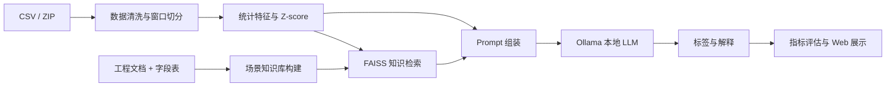

# RAGFault — Local LLM-Powered Industrial Anomaly Detection

**RAGFault** 是一个面向工业多变量时序数据的本地异常检测原型。系统将滑动窗口统计、Z-score 偏移、领域知识检索与本地大语言模型结合，输出窗口级异常标签、解释和检索证据，并提供可交互的 Web 演示界面。

> 本仓库是经脱敏整理的求职展示版本，只包含项目运行所需的源码、知识文本、配置样例和说明文档；不包含个人信息、原始数据、处理后数据、模型文件或密钥。

## 功能概览

- CSV/ZIP 工业传感器数据上传与窗口化处理
- 每个窗口的均值、标准差、最大值和相对基线 Z-score 计算
- 基于 Sentence Transformers 与 FAISS 的领域知识检索
- 通过本地 Ollama 模型完成异常判定与自然语言解释
- Precision、Recall、F1、FAR、MAR、Accuracy 与混淆矩阵计算
- Web 页面展示窗口详情、模型理由和 RAG 证据
- 根据工程说明文档和字段表构建新的场景知识库
- 独立的 HAI 场景适配与迁移实验流程

## 工作流程

1. 读取用户上传的 CSV，或解压 ZIP 中的 CSV。
2. 根据配置过滤启动阶段数据并建立正常基线。
3. 将多变量时序数据切分为窗口，计算统计量与 Z-score。
4. 从场景知识库检索与当前窗口最相关的规则和异常模式。
5. 将窗口特征与检索证据交给本地 LLM，获得异常判定和解释。
6. 根据数据标签计算评估指标，并在浏览器中展示窗口详情与证据。

## Architecture



## 技术栈

- Python 3.11（推荐）
- Flask、pandas、NumPy、SciPy、scikit-learn
- Sentence Transformers、FAISS
- Ollama + `llama3.1:8b`（检测）
- Ollama + `qwen2.5:7b`（从工程资料构建场景知识）
- 原生 HTML / CSS / JavaScript

## 目录结构

```text
.
├─ src/                         核心数据处理、检索、检测、评估与可视化
├─ frontend/                    Flask 服务和浏览器界面
├─ knowledge_base/              默认场景的可读知识与 Z-score 规则
├─ extension_experiment/        HAI 适配器、Prompt、配置和知识文本
├─ docs/                        架构、数据准备、演示与发布检查说明
├─ scripts/                     Windows 本地启动脚本
├─ config.example.yaml          可提交的配置样例
└─ requirements.txt             Python 依赖
```

FAISS 索引未提交；首次运行时由知识文本在本地生成。用户上传数据和运行输出同样被 `.gitignore` 排除。

## 快速开始（Windows PowerShell）

1. 安装 Python 3.11、[Ollama](https://ollama.com/) 并准备模型：

   ```powershell
   ollama pull llama3.1:8b
   ollama pull qwen2.5:7b
   ```

2. 在仓库根目录创建环境并安装依赖：

   ```powershell
   python -m venv .venv
   .\.venv\Scripts\Activate.ps1
   python -m pip install --upgrade pip
   pip install -r requirements.txt
   ```

3. 确保 Ollama 服务可用，然后启动 Web 演示：

   ```powershell
   python frontend\server.py
   ```

4. 浏览器访问 `http://127.0.0.1:8765`，上传你有权使用、且字段符合要求的 CSV 或 ZIP。

也可执行 `scripts\run_demo.ps1` 完成配置检查并启动服务。

## 输入数据

仓库不分发 SKAB、HAI 或任何真实采集数据。字段要求、目录放置方式及公开数据集来源提示见 [docs/DATA.md](docs/DATA.md)。默认 SKAB 流程的字段名由 `config.example.yaml` 的 `data.features` 定义；标签字段由数据处理代码识别。

命令行批处理入口：

```powershell
python src\main.py --config config.example.yaml --data_dir .\data\skab
```

HAI 扩展实验需要用户自行准备原始数据，并核对 `extension_experiment/configs/hai_transfer_config.example.yaml` 中的区间和字段：

```powershell
python extension_experiment\run_hai_experiment.py `
  --config extension_experiment\configs\hai_transfer_config.example.yaml
```

## English summary

This repository presents a privacy-cleaned research prototype for industrial multivariate time-series anomaly detection. It combines window statistics and baseline-relative Z-scores with FAISS retrieval over domain knowledge and a local Ollama-hosted LLM. The system provides window-level decisions, explanations, retrieved evidence, evaluation metrics, a Flask-based demo, scene knowledge-base construction, and an HAI adaptation workflow. Datasets, personal documents, credentials, model weights, and generated indexes are intentionally excluded.

## 数据与安全

- 仓库不包含原始数据、处理后数据、个人材料、密钥、模型权重或生成的向量索引。
- `data/`、上传文件、运行输出、场景索引和本地配置均已通过 `.gitignore` 排除。
- 更完整的发布检查见 [docs/PUBLICATION_REVIEW.md](docs/PUBLICATION_REVIEW.md)。

## 限制

- 需要本地运行 Ollama；首次加载嵌入模型或构建索引可能较慢。
- LLM 输出具有一定非确定性，模型版本与参数会影响结果。

## License

本项目基于 [MIT License](LICENSE) 开源。

